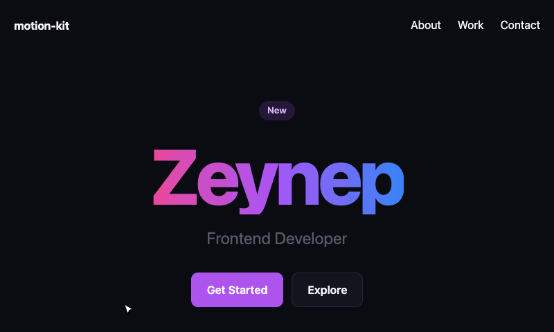
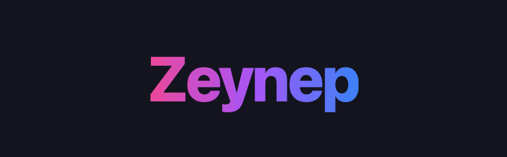
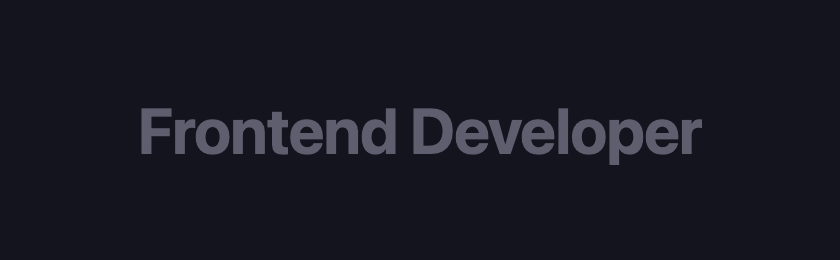
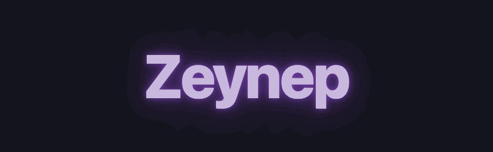
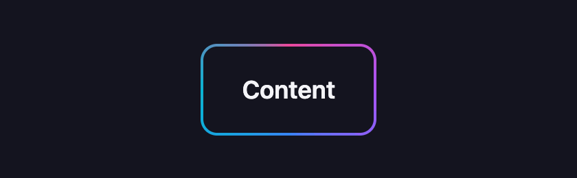
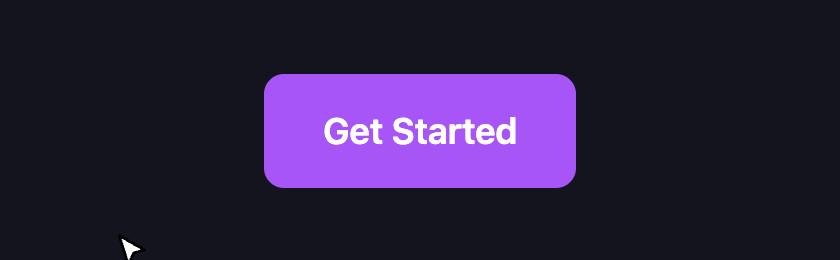
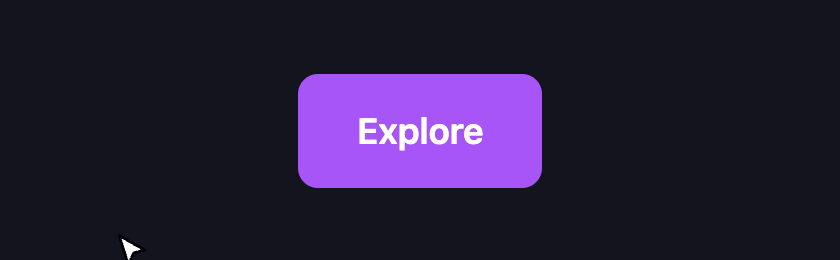
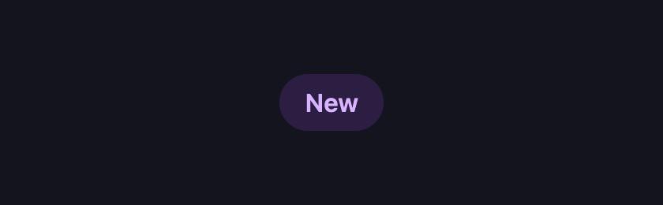
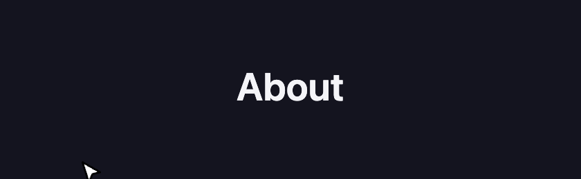

# motion-kit-css

Modern arayüzler için CSS ile oluşturulmuş, küçük bir animasyon efektleri koleksiyonu. JavaScript, herhangi bir framework veya yapılandırma gerektirmez. Tek bir stil dosyasını içe aktarın ve istediğiniz sınıfı ekleyin.

[](https://www.npmjs.com/package/motion-kit-css) [](LICENSE)

**Canlı demo:** [zeynepbas.dev/npm](https://www.zeynepbas.dev/npm) · **npm:** [npmjs.com/package/motion-kit-css](https://www.npmjs.com/package/motion-kit-css) · **GitHub:** [zeynepbass/motion-kit](https://github.com/zeynepbass/motion-kit)



## Özellikler

- Animasyonlu degrade metin
- Işıltı efekti (shimmer) içeren metin
- Parlama efekti (glow) içeren metin
- Animasyonlu degrade kenarlık
- Butonlarda yukarı kalkma ve parlama hover efektleri
- Nabız şeklinde parıltı efekti
- Hover sırasında animasyonlu alt çizgi
- `prefers-reduced-motion` ayarını dikkate alır
- Sıkıştırılmış ve Gzip uygulanmış boyutu yaklaşık 1,2 kB

## Kurulum

```bash
npm install motion-kit-css
```

## Kullanım

Vite, webpack, Parcel gibi bir paketleyiciyle veya `postcss-import` kullanarak:

```css
@import "motion-kit-css";
```

```js
import "motion-kit-css";
```

Ardından ilgili sınıfı ekleyin:

```html
<h1 class="motion-gradient">Zeynep</h1>
```

Sıkıştırılmış paketi kullanmak için:

```css
@import "motion-kit-css/min";
```

Tek bir efekti içe aktarmak için:

```css
@import "motion-kit-css/gradient.css";
```

Herhangi bir derleme adımı kullanmadan:

```html
<link rel="stylesheet" href="https://unpkg.com/motion-kit-css@1/dist/index.min.css">
```

## Kullanılabilir Efektler

Her efekt tek bir CSS sınıfıyla uygulanır. Özel CSS değişkenleri isteğe bağlıdır ve ilgili öğeye veya üst öğelerinden herhangi birine tanımlanabilir.

### Degrade metin (Gradient Text)



```html
<h1 class="motion-gradient">Zeynep</h1>
```

Kullanılabilir CSS değişkenleri:

- `--motion-gradient-colors`: Degrade renklerini belirler. Kesintisiz bir döngü elde etmek için ilk rengi listenin sonuna da ekleyin.
- `--motion-gradient-duration`: Animasyonun süresini belirler.

### Işıltılı metin (Shimmer Text)



```html
<h1 class="motion-shimmer">Frontend Developer</h1>
```

Metnin rengi hafifçe soluklaştırılır ve metnin üzerinde kendi renginde bir ışık vurgusu hareket eder.

Kullanılabilir CSS değişkenleri:

- `--motion-shimmer-base`: Metnin temel rengini belirler.
- `--motion-shimmer-highlight`: Işık vurgusunun rengini belirler.
- `--motion-shimmer-duration`: Animasyonun süresini belirler.

### Parlayan metin (Glow Text)



```html
<h1 class="motion-glow">Zeynep</h1>
```

Varsayılan olarak metnin kendi renginde bir parlama oluşturur. Koyu arka plan üzerindeki açık renkli metinlerle en iyi sonucu verir.

Kullanılabilir CSS değişkenleri:

- `--motion-glow-color`: Parlama rengini belirler.
- `--motion-glow-duration`: Animasyonun süresini belirler.

### Degrade kenarlık (Gradient Border)



```html
<div class="motion-border">İçerik</div>
```

Öğenin iç kısmı `--motion-border-fill` değişkeniyle renklendirilir. Varsayılan olarak sistemin `Canvas` rengi kullanılır.

Bu değişkeni kendi arayüzünüzün yüzey rengine göre ayarlayın. Belirlenen rengin opak olması gerekir.

Kullanılabilir CSS değişkenleri:

- `--motion-border-fill`: Kenarlığın iç kısmının rengini belirler.
- `--motion-border-colors`: Degrade kenarlık renklerini belirler.
- `--motion-border-width`: Kenarlığın kalınlığını belirler.
- `--motion-border-radius`: Kenarlığın köşe yuvarlaklığını belirler.
- `--motion-border-duration`: Animasyonun süresini belirler.

### Butonun yukarı kalkması (Button Lift)



```html
<button class="motion-button-lift">Başlayın</button>
```

Kullanılabilir CSS değişkeni:

- `--motion-lift-shadow`: Efekt sırasında kullanılacak gölgeyi belirler.

### Buton parlama efekti (Button Shine)



```html
<button class="motion-button-shine">Keşfet</button>
```

Bu efekt, öğeye `position: relative` ve `overflow: hidden` özelliklerini uygular. Ayrıca öğenin `::after` sözde öğesini kullanır.

Kullanılabilir CSS değişkenleri:

- `--motion-shine-color`: Parlama rengini belirler.
- `--motion-shine-duration`: Animasyonun süresini belirler.

### Nabız efekti (Pulse)



```html
<span class="motion-pulse">Yeni</span>
```

Bu efekt `box-shadow` özelliğini animasyonlu hâle getirir. Bu nedenle öğede zaten bir gölge varsa mevcut gölgenin yerini alır.

Kullanılabilir CSS değişkenleri:

- `--motion-pulse-color`: Parlama rengini belirler.
- `--motion-pulse-size`: Parlama boyutunu belirler.
- `--motion-pulse-duration`: Animasyonun süresini belirler.

### Hover alt çizgisi (Hover Underline)



```html
<a class="motion-underline" href="#">Hakkında</a>
```

Bu efekt varsayılan alt çizgiyi kaldırır. Bu nedenle gövde metninin içindeki bağlantılardan ziyade navigasyon bağlantılarında kullanılması önerilir.

Kullanılabilir CSS değişkenleri:

- `--motion-underline-color`: Alt çizginin rengini belirler.
- `--motion-underline-thickness`: Alt çizginin kalınlığını belirler.
- `--motion-underline-duration`: Animasyonun süresini belirler.

### Özelleştirme

Efektleri CSS değişkenleri aracılığıyla özelleştirebilirsiniz:

```css
.hero-title {
  --motion-gradient-colors: #f97316, #ef4444, #f97316;
  --motion-gradient-duration: 10s;
}
```

## Erişilebilirlik

Kullanıcı cihazında `prefers-reduced-motion: reduce` ayarı etkinse animasyonlar aşağıdaki şekilde davranır:

- Degrade metin, parlama, nabız ve degrade kenarlık görünür kalır ancak animasyonları durur.
- Işıltılı metin normal metin rengine döner.
- Butonun yukarı kalkma efekti hareket etmeden gölge değişimini korur; buton parlama efekti devre dışı bırakılır.
- Alt çizgi animasyon beklemeden anında görünür.

Hover efektleri `:focus-visible` durumunda da uygulanır. Ayrıca yalnızca hover desteği bulunan cihazlarda etkinleşir. Böylece dokunmatik ekranlarda bir öğeye dokunulduktan sonra efektin takılı kalması önlenir.

## Tarayıcı Desteği

Chrome, Edge, Firefox ve Safari tarayıcılarının güncel sürümleri desteklenir.

- Işıltı, parlama ve nabız efektleri `color-mix()` kullanır: Chrome 111+, Firefox 113+, Safari 16.2+.
- Kenarlık animasyonu `@property` kullanır: Chrome 85+, Safari 16.4+, Firefox 128+. Daha eski tarayıcılarda animasyonsuz, statik bir degrade kenarlık görüntülenir.

## Geliştirme

```bash
npm install
npm run build
npm test
```

`src/` klasöründe her efekt için ayrı bir dosya bulunur. `npm run build` komutu yayımlanmaya hazır CSS dosyalarını `dist/` klasörüne oluşturur.

Tüm efektleri görmek için derleme işleminden sonra `demo/index.html` dosyasını tarayıcıda açın.

## Sürüm Yönetimi

Bu proje, [Semantic Versioning](https://semver.org) (Anlamsal Sürümleme) standardını (`MAJOR.MINOR.PATCH`) kullanır:

- `MAJOR`: Bir sınıf veya özel CSS değişkeni yeniden adlandırılır ya da kaldırılırsa veya mevcut düzenleri bozabilecek bir efekt değişikliği yapılırsa artırılır.
- `MINOR`: Yeni efektler veya yeni özel CSS değişkenleri eklendiğinde artırılır.
- `PATCH`: Hata düzeltmeleri ve görsel iyileştirmeler yapıldığında artırılır.
